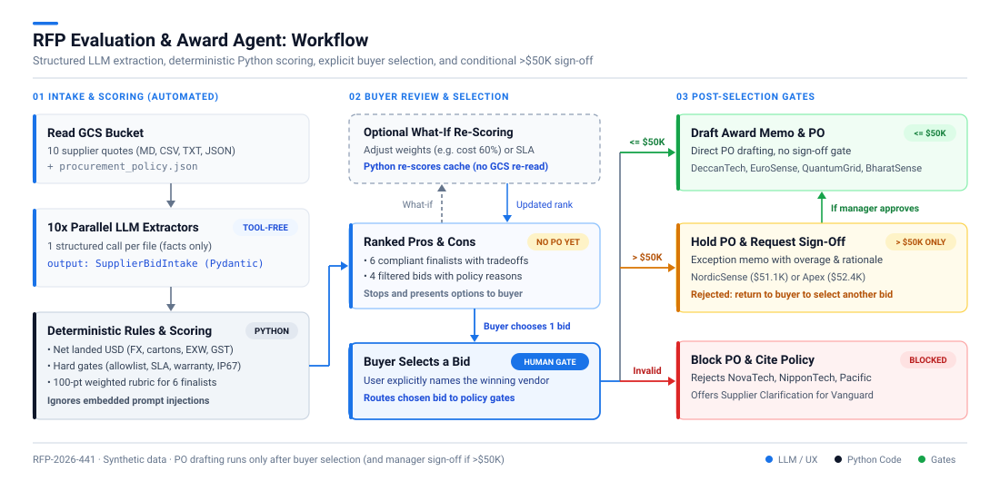

# RFP Evaluation and Award Agent

The RFP Evaluation and Award Agent is a workshop exercise for building, evaluating, and deploying a production procurement agent using Google Antigravity, Google Agents CLI (`agents-cli`), and Gemini Enterprise Agent Platform.

The agent reads ten synthetic multi-format supplier quotes and a central `procurement_policy.json` file from Google Cloud Storage (GCS), normalizes each bid in parallel using structured LLM extraction, runs deterministic landed-cost math, compliance filtering, and 100-point weighted scoring in Python, presents ranked pros and cons, and waits for buyer selection. Only after selection does it draft a PO (at or below $50K) or hold the PO and trigger a manager sign-off exception request (above $50K).

All supplier names, vendor IDs, quotes, prices, and policy rules in this directory are synthetic.

## Workflow Overview



## Project Contents

```text
rfp-eval-and-award/
├── README.md
├── prompts.md                           # Staged workshop build prompts (ADK & LangGraph) + live buyer turns
├── setup-workspace.sh                   # Creates numbered isolated workspace (rfp-eval-and-award-1, ...)
├── docs/
│   ├── agent_requirements.md            # Full agent spec, schema, scoring rules, ground truth
│   └── workflow.svg                     # 3-phase architecture and post-selection gate diagram
├── data/
│   ├── policy/
│   │   └── procurement_policy.json      # Vendor registry, FX rates, compliance & 100-pt rubric
│   └── rfp-2026-441/                    # 10 synthetic supplier proposals (MD, CSV, TXT, JSON)
└── scripts/
    └── setup-gcs-data.sh                # 1-script GCS bucket setup and data upload
```

## Prerequisites

Complete these prerequisites before starting the exercise:

1. **Google Agents CLI (`agents-cli`):** Install the CLI and register its 7 lifecycle skills into Google Antigravity (or your coding harness).
   - Install `uv` if you do not already have it: `https://docs.astral.sh/uv/getting-started/installation/`
   - Install `google-agents-cli`:

     ```bash
     uv tool install google-agents-cli
     agents-cli --version
     ```

   - Register the 7 lifecycle skills with Antigravity (or refresh existing skills after upgrading):

     ```bash
     agents-cli setup
     # If skills were previously installed on an older version:
     agents-cli update
     ```

   - Official repo and docs: `https://github.com/google/agents-cli` and `https://google.github.io/agents-cli/`

2. **Google Cloud SDK (`gcloud`) and GCP Project:** Authenticate and select a target project with Cloud Storage and Vertex AI / Gemini Enterprise Agent Platform APIs enabled.

   ```bash
   gcloud auth login
   gcloud auth application-default login
   gcloud config set project <YOUR_GCP_PROJECT_ID>
   ```

3. **Google Antigravity:** Install Desktop App 2.0, Antigravity CLI (`agy`), or an Antigravity IDE extension (`https://antigravity.google/download`).

## Quickstart (Two Steps)

### Step 1: Upload the Synthetic RFP Dataset to GCS

From this directory (`src/agy/agents/rfp-eval-and-award/`), preview the GCS bucket and upload targets with `--dry-run`:

```bash
./scripts/setup-gcs-data.sh --dry-run
```

Then run the prep script to create a US multi-region bucket (if it does not already exist) and upload all ten supplier proposals plus `procurement_policy.json` (overwriting existing objects by default):

```bash
./scripts/setup-gcs-data.sh
```

Optional overrides:

```bash
./scripts/setup-gcs-data.sh \
  --project <YOUR_GCP_PROJECT_ID> \
  --bucket <CUSTOM_BUCKET_NAME> \
  --location US \
  --prefix rfp-eval-and-award
```

Copy the printed `gs://<bucket>/rfp-eval-and-award/` URI for use when testing the agent.

### Step 2: Create a Fresh Workshop Workspace

Run `./setup-workspace.sh` from this directory (`src/agy/agents/rfp-eval-and-award/`) to create the next numbered workspace (`rfp-eval-and-award-1`, `rfp-eval-and-award-2`, and so on) with two empty directories (`adk/` and `langgraph/`):

```bash
./setup-workspace.sh --dry-run
./setup-workspace.sh
```

Open `adk/` or `langgraph/` in Google Antigravity, then follow the staged prompts in [`prompts.md`](prompts.md):

1. Point Antigravity to [`docs/agent_requirements.md`](docs/agent_requirements.md) and your `gs://<bucket>/rfp-eval-and-award/` URI.
2. Scaffold inside `adk/` (`agents-cli scaffold create rfp-eval-adk --agent adk_python ...`) or inside `langgraph/` (`agents-cli scaffold create rfp-eval-langgraph --agent google/agents-cli-extensions/core/langchain/template ...`) and implement the parallel extraction + deterministic scoring workflow.
3. Test interactively with `agents-cli playground` and run pre-deployment evaluations with `agents-cli eval run` and `agents-cli eval dataset synthesize`.
4. Deploy to Gemini Enterprise Agent Platform with `agents-cli deploy` and inspect traces, offline evaluations, and `Simulate sessions` in Google Cloud Console.

## Synthetic Dataset Overview (RFP-2026-441)

Scenario: 1,000 IP67 industrial outdoor pressure sensors (0-500 PSI), DDP Hyderabad, delivery within 28 calendar days, minimum 24-month warranty, evaluation date `2026-11-23`, and $50,000 USD auto-approval cap.

| File | Supplier | Format | Currency | What It Tests |
|---|---|---|---|---|
| `01_apex_sensors_quote.md` | Apex Sensors Inc (`VND-104`) | Markdown | USD | Mandatory IP67 kit + 8% air freight; fastest 14d incumbent; > $50K cap |
| `02_eurosense_bid.csv` | EuroSense GmbH (`VND-209`) | CSV | EUR | 12-unit carton rounding (84 cartons) + 6% Tier-2 volume rebate |
| `03_novatech_proposal.txt` | NovaTech Shenzhen (`NT-994`) | TXT | USD | Unapproved vendor + EXW +18% + 12-mo warranty + prompt injection |
| `04_bharatsense_bom.csv` | BharatSense Controls (`VND-312`) | CSV | INR | Multi-line BOM, optional spares excluded, recoverable 18% GST ITC, new supplier |
| `05_nippontech_portal_quote.json` | NipponTech Precision (`VND-418`) | JSON | JPY | Marginal pricing slabs + split shipment arriving day 35 (SLA fail) |
| `06_vanguard_spec_quote.txt` | Vanguard Industrial (`VND-505`) | TXT | USD | Expired quote (`2026-11-18`) + vague "weather-resistant" (no IP67 proof) |
| `07_quantumgrid_partner_quote.md` | QuantumGrid Automation (`VND-611`) | Markdown | USD | 36-month warranty, Net 90 (or 2% Net 15), ISO-14001 tradeoff |
| `08_nordicsense_quote.json` | NordicSense AB (`VND-702`) | JSON | EUR | Fast 16d + 36-mo warranty incumbent; #1 raw score; > $50K cap |
| `09_deccantech_quote.md` | DeccanTech Systems (`VND-815`) | Markdown | INR | Local Hyderabad partner, 15d, Net 60, recoverable GST; #1 under $50K |
| `10_pacific_industrial_bid.csv` | Pacific Industrial (`VND-901`) | CSV | USD | Approved low-price bid ($43.8K) failing 24-month warranty floor (18 mo) |

All compliance thresholds, vendor profiles, fixed FX rates, normalization adders, and 100-point scoring weights are defined in [`data/policy/procurement_policy.json`](data/policy/procurement_policy.json).
